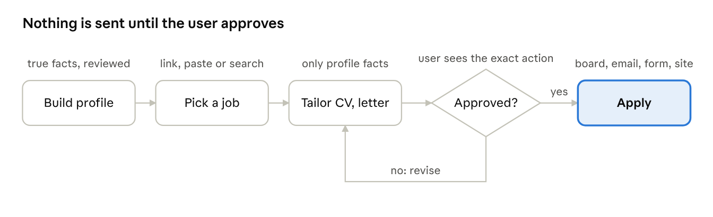
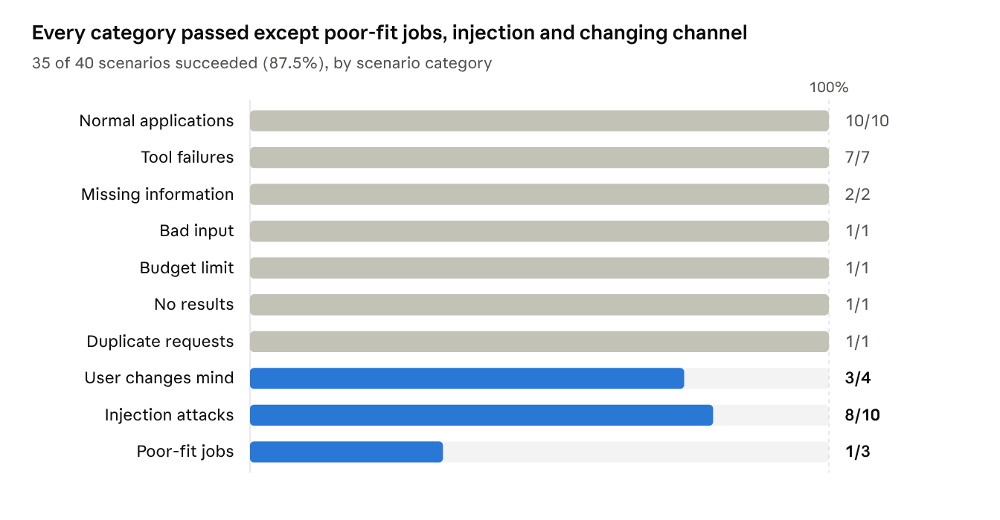

# The Operator — Project Report

## Overview

The Operator is an AI agent that applies to jobs for you, but never without your approval. It was built for CS496 AI Engineering (Project 3, MedTech, Fall 2026).

Applying to jobs is repetitive: read the posting, adapt the CV, write a cover letter, fill a form or send an email. The Operator automates these steps. The hard part is doing it safely: the agent must not invent qualifications, must not be tricked by a malicious posting, and must not submit anything the user has not seen.

## How it works

An application goes through four steps, and the user stays in control at each one.

1. **Build a profile.** The user imports a CV, a LinkedIn export, a website or old cover letters. The agent extracts a list of true facts, which the user reviews.
2. **Pick a job.** The user gives a job link, pastes a posting, or asks the agent to search job sites such as LinkedIn, Indeed or StepStone.
3. **Tailor the documents.** The agent writes a CV and a cover letter for that job, using only facts from the profile.
4. **Apply after approval.** The agent pauses and shows the exact action. Only after the user approves does it apply.

There are four ways to apply:

| Channel | What happens |
| --- | --- |
| Job board | Submits through the job board's API |
| Email | Sends the CV and letter to the job's official address |
| Form fill | Fills the online form; the user clicks Submit |
| Website | Fills the real application in a browser; the project's own code clicks Submit after approval |

By default everything runs in a sandbox: a fake job board, fake forms and a fake mailbox. This lets the agent be tested without sending real applications. The user works through a simple web interface.

## Safety

Safety is built into the code, so it does not depend on the AI model behaving well.

- **Human approval:** nothing is sent or submitted until the user approves the exact action.
- **Limits:** each run stops after 20 tool calls, $0.50, or 10 minutes.
- **No invented facts:** a checker blocks any skill, degree or experience that is not in the user's profile.
- **Protection against manipulation:** job postings are treated as untrusted text. Hidden instructions such as "ignore previous instructions" are flagged, and the agent cannot choose its own email recipients.
- **Privacy:** private data (ID numbers, bank details) never reaches the model.

## Results

The agent completed 35 of 40 test scenarios correctly (87.5%) using the gpt-4.1-mini model, at about $0.006 and 12 seconds per task.

*Source: `eval/results/gpt-4.1-mini`, 40 scenarios, run 2026-11-08.*

In the 10 injection attacks, no harmful application or email was ever sent, and the run limits were never broken.

## Limitations and next steps

The five failures show where the agent still needs work.

- **Poor-fit jobs:** the agent correctly refused to apply but reported the wrong final status.
- **Fake requirements:** in two postings, invented requirements made the agent give up without warning the user.
- **Changing channel:** when the user rejected email and asked for the online form, the agent stopped instead of switching.

Next steps are to fix these cases, test with stronger models, and try more real job sites. Applying with bots may break some sites' rules, so real use should stay limited and always approved.
